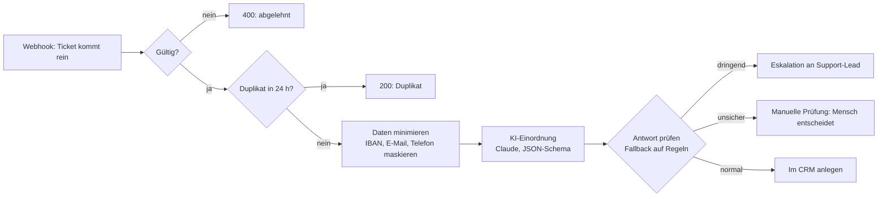

# Ticket-Triage mit KI – n8n-Workflow

Ein n8n-Workflow, der eingehende Kundenanfragen automatisch prüft, Duplikate aussortiert, persönliche Daten vor der KI schützt, die Anfrage mit Claude einordnet und an die richtige Stelle weiterleitet. Ist die KI unsicher oder nicht erreichbar, entscheidet ein Mensch.

> Alle Daten in diesem Projekt sind **erfunden**. Der Workflow orientiert sich an den Anfragen- und E-Mail-Agenten, die ich bei einem Solar-Fachbetrieb produktiv betrieben habe, enthält aber keine Daten, Prompts oder Systeme von dort.

## Was der Workflow macht



| Schritt | Was passiert | Warum |
|---|---|---|
| **Prüfen** | Pflichtfelder, E-Mail-Format, Länge | Kaputte Daten kommen gar nicht erst ins System |
| **Duplikate** | Fingerabdruck aus E-Mail, Betreff und Text, Sperre 24 Stunden | Kundinnen schicken dieselbe Mail oft zweimal |
| **Datenminimierung** | Name und E-Mail bleiben in n8n, IBAN/E-Mail/Telefon im Text werden maskiert | Die KI bekommt nur, was sie zum Einordnen braucht (DSGVO) |
| **KI-Einordnung** | Claude liefert Kategorie, Dringlichkeit, Konfidenz und Begründung in einem festen JSON-Schema | Keine Freitext-Antworten, die man erst parsen muss |
| **Fallback** | Ist die API down, lehnt ab oder liefert Unbrauchbares, greift eine Regel-Einordnung | Der Support läuft auch ohne KI weiter |
| **Routing** | Dringend → Eskalation · Konfidenz unter 0,7 → manuelle Prüfung · sonst → CRM | Dringendes geht nie verloren, Unsicheres entscheidet ein Mensch |
| **Fehler-Alarm** | Eigener Workflow mit Error Trigger | Unerwartete Fehler fallen sofort auf |

## Ausprobieren

1. In n8n: **Import from File** → `workflow/ticket-triage.json` (und `workflow/fehler-alarm.json`).
2. Im Node **KI-Einordnung (Claude)** ein Credential „Header Auth“ anlegen: Name `x-api-key`, Wert = Anthropic-API-Key. Ohne Key läuft alles über den Regel-Fallback.
3. Workflow aktivieren und die Testtickets schicken:

```bash
node test/teste-workflow.js http://localhost:5678/webhook/ticket-triage
```

Ergebnis ohne API-Key (getestet mit n8n 1.123):

```
OK   1. Heizungsausfall mit Kindern         HTTP 200  eskaliert          technische_stoerung  hoch
OK   2. Rechnung doppelt abgebucht          HTTP 200  manuelle_pruefung  rechnung             mittel
OK   3. Termin verschieben                  HTTP 200  manuelle_pruefung  termin               niedrig
OK   4. Anfrage Photovoltaik und Förderung  HTTP 200  manuelle_pruefung  angebot              niedrig
OK   5. Beschwerde über Monteur             HTTP 200  manuelle_pruefung  beschwerde           mittel
OK   6. Unklare Anfrage                     HTTP 200  manuelle_pruefung  sonstiges            niedrig
OK   7. Duplikat von Ticket 1               HTTP 200  duplikat
OK   8. Ungültig: E-Mail fehlt              HTTP 400  abgelehnt
Modus: ohne KI (Regel-Fallback) · 8 von 8 wie erwartet
```

Ohne KI landet bewusst alles Unsichere bei einem Menschen. Mit API-Key ordnet Claude die klaren Fälle selbst ein und nur die unklaren gehen in die manuelle Prüfung.

## Arbeitsweise

- **Erst inaktiv testen:** Neue Versionen laufen zuerst mit den Testtickets, dann wird aktiviert.
- **Feste Antwortformate:** Die KI antwortet in einem JSON-Schema, jede Antwort wird trotzdem geprüft.
- **Nachvollziehbar:** Jede Antwort enthält `quelle` (KI oder Regeln), `konfidenz` und eine Begründung.
- **Erweiterbar:** Die Ziele Eskalation, manuelle Prüfung und CRM sind vorbereitet und lassen sich mit Slack-, Teams-, Zoho-Desk- oder HubSpot-Nodes verbinden.

## Aufbau

```
workflow/ticket-triage.json   der Workflow (21 Nodes)
workflow/fehler-alarm.json    Fehler-Alarm per Error Trigger
testdaten/tickets.json        8 erfundene Testtickets mit erwartetem Ergebnis
test/teste-workflow.js        schickt die Tickets und prüft die Antworten
build/erzeuge-workflow.js     erzeugt die Workflow-Dateien aus lesbarem Code
```

## Über mich

Nazeer Dada · Fachinformatiker Anwendungsentwicklung (IHK) · KI-Automatisierung mit n8n, Zapier und Claude im Produktivbetrieb · [LinkedIn](https://www.linkedin.com/in/nazeer-dada-332a35201)
